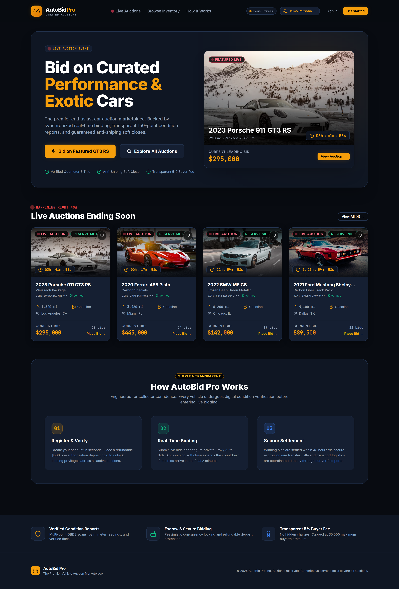
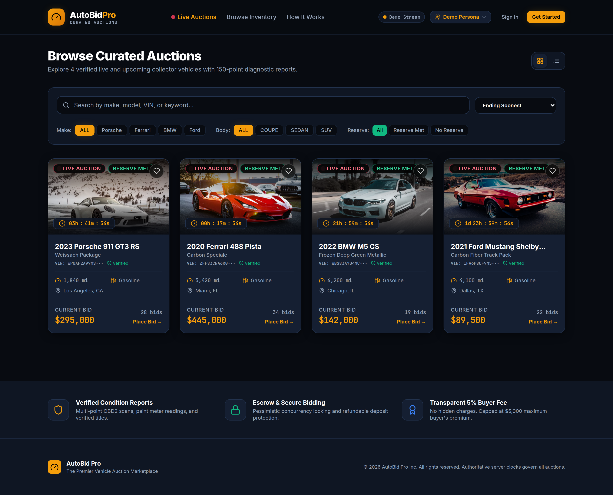
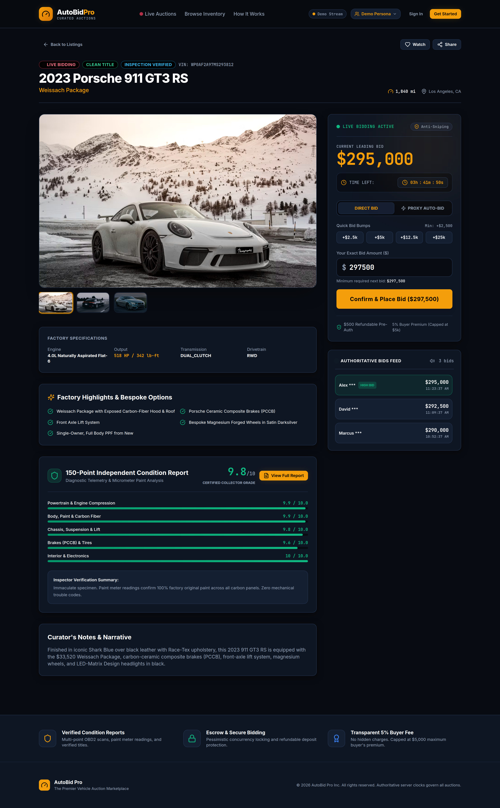
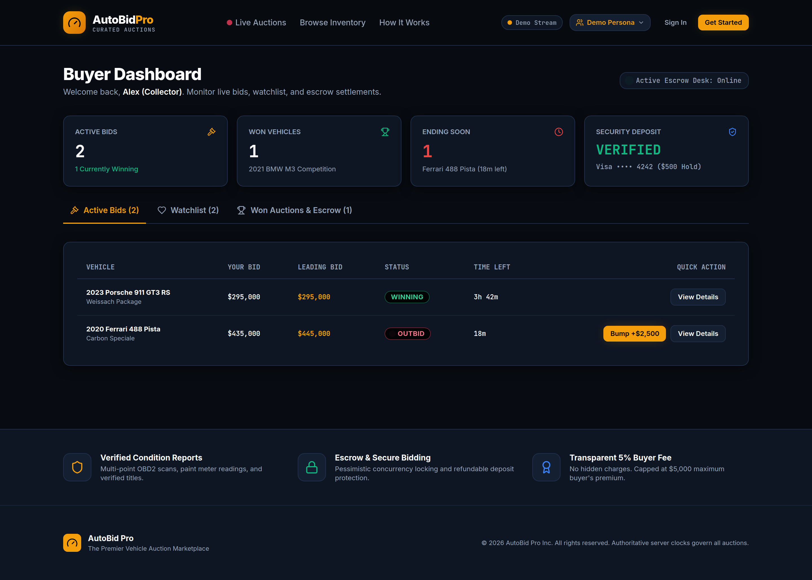
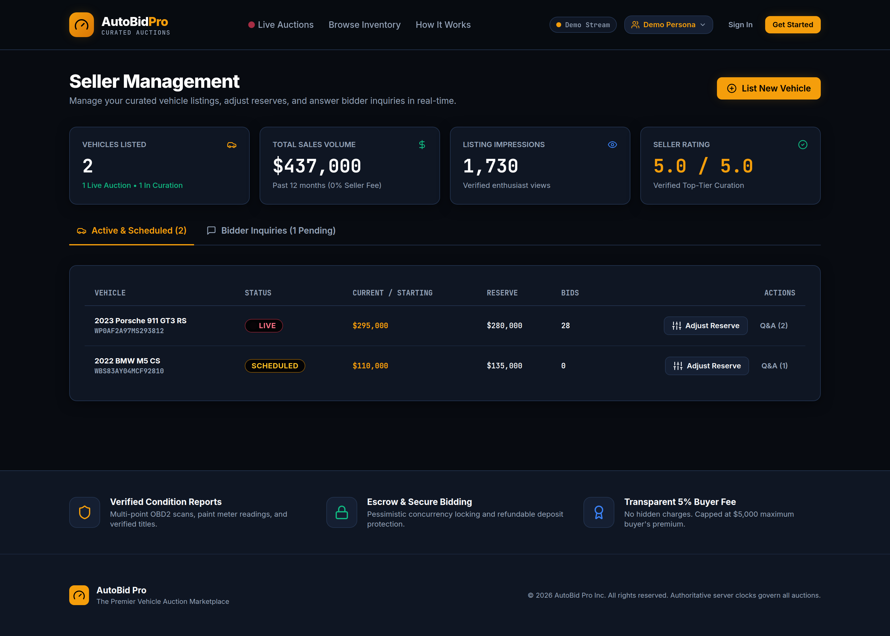
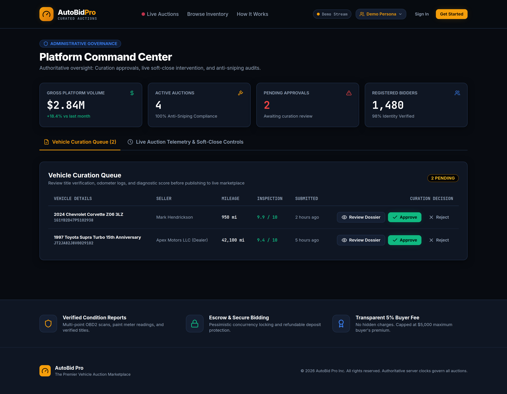
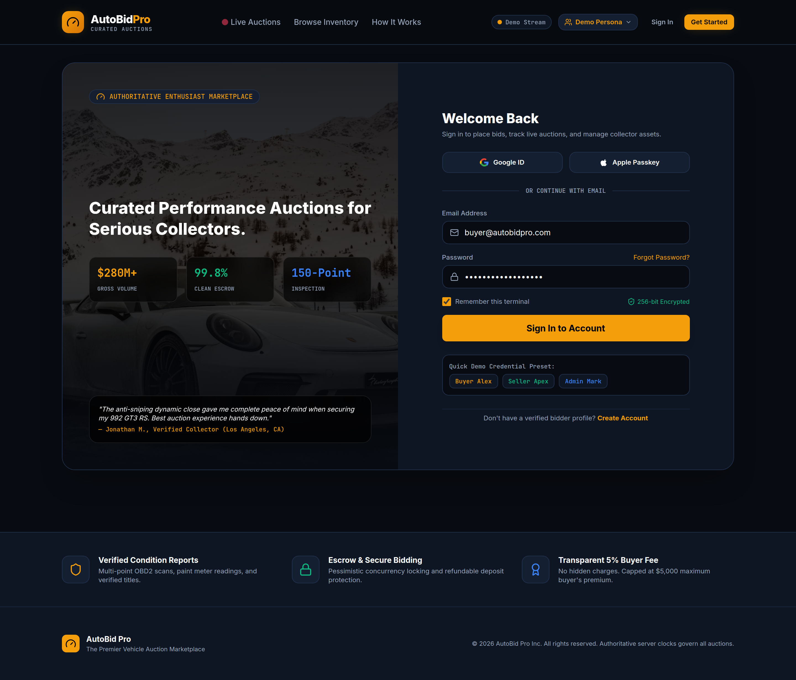
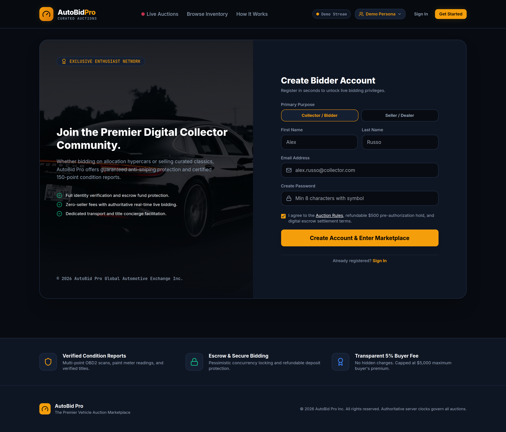
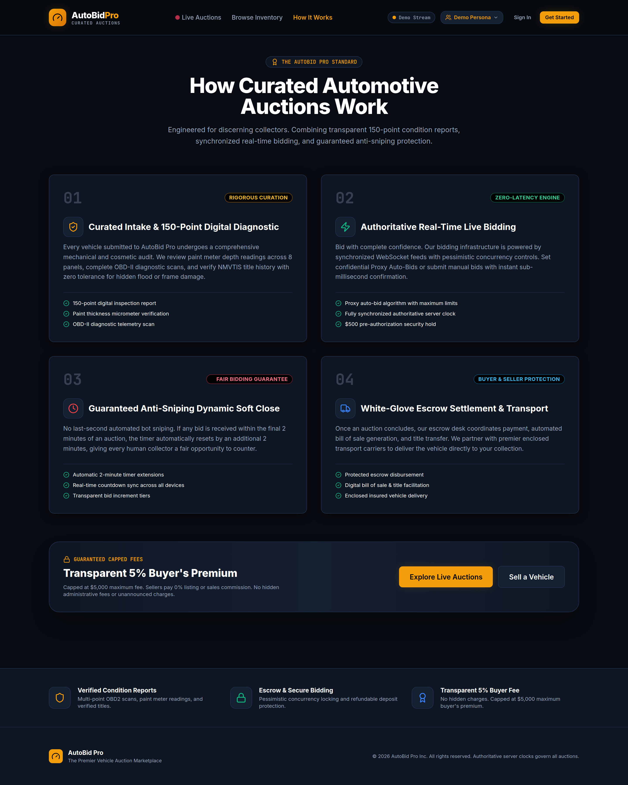

# 🏎️ AutoBid Pro — Enterprise Automobile Auction & Bidding Marketplace

[](https://autobid-pro.vercel.app)
[-339933?logo=node.js&logoColor=white)](https://nodejs.org/)
[](https://developer.mozilla.org/en-US/docs/Web/JavaScript)
[](https://react.dev/)
[](https://www.postgresql.org/)
[](https://redis.io/)
[](https://socket.io/)
[](https://www.docker.com/)
[](docs/security/asvs_security_audit.md)
[](LICENSE)

**AutoBid Pro** is a production-grade, full-stack online car auction and real-time bidding platform engineered for high-value classic, collector, exotic, and luxury automobiles.

Authored strictly in **Pure Modern JavaScript (ECMAScript 2024+ / Node.js 22 LTS with native ES Modules `"type": "module"`)** and modern React JSX, the platform delivers the architecture, security, and concurrency controls demanded by serious commercial marketplace platforms.

---

### 🌐 Live Production Links

| Resource | URL | Status |
| :--- | :--- | :--- |
| **Production Web Platform** | [https://autobid-pro.vercel.app](https://autobid-pro.vercel.app) | **Live & Operational** |
| **API Gateway Probe** | [https://autobid-pro.vercel.app/api](https://autobid-pro.vercel.app/api) | **HTTP 200 OK** |
| **Health Check Endpoint** | [https://autobid-pro.vercel.app/health](https://autobid-pro.vercel.app/health) | **HTTP 200 OK** |
| **GitHub Repository** | [https://github.com/kashifhm333/AutoBid-Pro](https://github.com/kashifhm333/AutoBid-Pro) | **Main Branch Synced** |

---

## 📑 Table of Contents

- [Platform Visual Showcase](#-platform-visual-showcase)
- [The Problems It Solves](#-the-problems-it-solves)
- [Key Features](#-key-features)
- [System Architecture](#-system-architecture)
- [UML & Domain Diagrams](#-uml--domain-diagrams)
- [Monorepo Directory Structure](#-monorepo-directory-structure)
- [Prerequisites](#-prerequisites)
- [How to Run Locally](#-how-to-run-locally)
  - [Option 1: One-Command Docker Compose (Recommended)](#option-1-one-command-docker-compose-recommended)
  - [Option 2: Local Development Setup](#option-2-local-development-setup)
- [Deployment on Vercel](#-deployment-on-vercel)
- [Pre-Configured Demo Accounts](#-pre-configured-demo-accounts)
- [Testing & Quality Assurance](#-testing--quality-assurance)
- [Core API Routes](#-core-api-routes)
- [Security & Compliance](#-security--compliance)
- [License](#-license)

---

## 📸 Platform Visual Showcase

Here is a comprehensive walkthrough of the 9 production views engineered for AutoBid Pro:

### 1. Home Page & Featured Live Auction
The platform entry experience highlights active featured supercars with synchronized live countdowns, verified condition pills, and immediate bidding entry.


---

### 2. Curated Vehicle Inventory & Multi-Filter Catalog
Browse live inventory with faceted search across make, model, year, transmission, price brackets, and live auction status tags.


---

### 3. Auction Details, Lightbox Gallery & 150-Point Digital Inspection
Full auction command rail featuring an unclipped bidding HUD, authoritative real-time bid feed, proxy bidding mode, full-screen lightbox photo modal, and a comprehensive 150-point diagnostic inspection modal with 8-panel paint meter depth readings.


---

### 4. Buyer Dashboard & Escrow Desk
Collector dashboard featuring tabbed views for **Active Bids** (Winning vs Outbid tags with direct quick bump action), **Watchlist**, and **Won Auctions & Escrow Settlements** with $500 pre-auth deposit card management.


---

### 5. Seller Consignment Hub & Listing Wizard
Consignor portal enabling sellers to manage live lots, adjust reserve thresholds, answer buyer inquiries in real time, and launch a 4-step listing creation wizard with mock VIN auto-decoding.


---

### 6. Admin Governance & Platform Command Center
Authoritative governance console featuring a vehicle curation queue with dossier inspection, real-time auction pause/resume controls, and manual soft-close anti-sniping extension interventions.


---

### 7. Split-Screen Authentication & 1-Click Persona Switcher
50/50 responsive login split screen displaying platform transaction volume metrics, verified collector quotes, social auth triggers, and 1-click instant demo persona switching for immediate testing.


---

### 8. Collector & Bidder Registration
Seamless onboarding screen allowing new users to select their primary platform role (Collector/Bidder vs Seller/Dealer) and review escrow terms.


---

### 9. How It Works & Anti-Sniping Dynamic Soft-Close Walkthrough
Interactive 4-stage educational guide detailing the digital inspection audit, zero-latency bidding engine, anti-sniping dynamic extension (+120s), and white-glove transport logistics.


---

## 🎯 The Problems It Solves

Commercial automotive auction platforms face acute technical and operational hurdles that trivial CRUD systems cannot handle:

1. **The Bidding Concurrency Race Condition**:
   - *Problem*: High-frequency competing bids arriving at the exact same millisecond cause dirty reads, duplicate winning prices, and phantom outbids.
   - *Solution*: PostgreSQL **pessimistic row-level locking (`SELECT ... FOR UPDATE`)** inside an ACID transaction on the auction record, strictly serializing bids and enforcing monotonic increment ladders.
2. **The Last-Second Sniper Bot Attack**:
   - *Problem*: Automated bots submit bids milliseconds before auction close, denying human bidders a fair opportunity to react.
   - *Solution*: **Anti-Sniping Dynamic Soft Close**. Any valid bid placed within the final 120 seconds automatically extends the auction deadline by 120 seconds (up to 10 extensions), immediately broadcasting `auction:extended` to all active clients.
3. **Global Client Clock Drift**:
   - *Problem*: End-user system clocks regularly drift by seconds or minutes from true UTC epoch, causing premature or delayed countdown expirations on client UIs.
   - *Solution*: Authoritative server NTP-style handshake (`timer:sync`), calculating client-to-server offset ($\Delta t = T_{\text{server}} - T_{\text{client}}$) for synchronized millisecond countdown timers.
4. **Bidder Default & Non-Performance**:
   - *Problem*: Winning bidders failing to settle invoices after high-stakes auctions.
   - *Solution*: **$500 Pre-Authorization Hold Model**. Bidders establish an authorized hold (`capture_method: manual`) via Stripe prior to bidding. Unused holds release automatically upon auction closure.
5. **Cardholder Data Risk & PCI Liability**:
   - *Problem*: Storing raw card data introduces severe legal, regulatory, and security liabilities.
   - *Solution*: **PCI-DSS SAQ-A Compliance**. Zero raw cardholder numbers or CVVs touch application servers. All payments utilize client-side tokenization, and webhooks are cryptographically validated via HMAC SHA-256 signatures with database deduplication.
6. **Condition Ambiguity & Fraudulent Listings**:
   - *Problem*: Unreported bodywork damage and undocumented mechanical faults.
   - *Solution*: **150-Point Digital Inspection Scorecards** with 8-panel paint meter readings and OBD-II diagnostics, backed by an 11-step vehicle lifecycle finite state machine.

---

## ✨ Key Features

- 🏎️ **Real-Time Bidding Gateway**: Instant bid broadcasting and outbid alerts via Socket.IO clustered through Redis Pub/Sub (`@socket.io/redis-adapter`).
- 🤖 **Proxy (Auto) Bidding Engine**: Bidders set private maximum ceilings; the system automatically places the minimum necessary counter-bid whenever challenged.
- ⏱️ **Anti-Sniping Soft Closes**: Configurable extension windows (+120s) with real-time UI synchronized updates.
- 🛡️ **11 Platform User Roles (Granular RBAC)**: Dual-guard authorization (`requireRole`, `requirePermission`) spanning Super Admin, Admin, Auction Manager, Inspector, Dealer, Seller, Buyer, Escrow Agent, Transport Partner, Detailer, and Support Agent.
- 🔍 **Vehicle Curation & Lifecycle FSM**: 11 validated status transitions (`DRAFT` $\rightarrow$ `SUBMITTED` $\rightarrow$ `UNDER_REVIEW` $\rightarrow$ `APPROVED` $\rightarrow$ `SCHEDULED` $\rightarrow$ `LIVE` $\rightarrow$ `EXTENDED` $\rightarrow$ `ENDED` $\rightarrow$ `SOLD` $\rightarrow$ `COMPLETED` $\rightarrow$ `CANCELLED`).
- 📍 **150-Point Inspection & Paint Depth Telemetry**: Certified scorecard ratings, OBD-II diagnostic scans, and micrometer readings across all panels.
- 💳 **PCI-DSS SAQ-A Financials**: Tiered 5% buyer's premium calculation bounded by a **$500 floor** and **$5,000 cap**, generating immutable `INV-YYYYMMDD-XXXX` invoices.
- 📜 **Immutable Governance Audit Trails**: Atomic recording of `AdminAction` and `AuditLog` records storing JSON state diffs (`previousStatus`, `newStatus`, `reason`).
- 🎨 **Dark Luxury Automotive UI**: Bespoke Obsidian (`#080B11`), Electric Amber (`#F59E0B`), and Racing Emerald (`#10B981`) glassmorphic aesthetic.
- 📦 **Multi-Stage Containerization**: Minimal Alpine images running unprivileged `node` users with `dumb-init` PID 1 signal supervisors.

---

## 🏗️ System Architecture

```
                                  ┌───────────────────────────┐
                                  │   React 18 SPA (Vite 6)   │
                                  │   Dark Luxury Automotive  │
                                  └─────────────┬─────────────┘
                                                │ HTTP / WSS
                                                ▼
                                  ┌───────────────────────────┐
                                  │    Nginx 1.27 (Alpine)    │
                                  │  SPA Fallback + Gzip/Cache│
                                  └─────────────┬─────────────┘
                                                │ Reverse Proxy
                                                ▼
┌─────────────────────────────────────────────────────────────────────────────────────────────┐
│                             Express 4.21 Modular Monolith (ESM)                             │
├──────────────────┬──────────────────┬──────────────────┬──────────────────┬─────────────────┤
│   Auth & IAM     │  Vehicles & FSM  │  Auctions & Soft │  Bidding Engine  │  Stripe SAQ-A   │
│  Rotating Tokens │ 2D Hotspot Insp. │   Anti-Sniping   │ Pessimistic Lock │ HMAC Webhooks   │
└────────┬─────────┴────────┬─────────┴────────┬─────────┴────────┬─────────┴────────┬────────┘
         │                  │                  │                  │                  │
         ▼                  ▼                  ▼                  ▼                  ▼
┌─────────────────────────────────────────────────────────┐  ┌────────────────────────────────┐
│             PostgreSQL 16 Relational DB                 │  │            Redis 7             │
│        (60 Normalized Models / Prisma ORM)              │  │  (Socket.IO PubSub & BullMQ)   │
└─────────────────────────────────────────────────────────┘  └────────────────────────────────┘
```

---

## 📐 UML & Domain Diagrams

Comprehensive architectural diagrams and security verification matrices are available in the [`docs/digrams/`](docs/digrams/) directory:

- 🧱 **[Class Diagram & OO Domain Model](docs/digrams/class_diagram.md)**: Full Object-Oriented domain hierarchy (User, Vehicle, Auction, Bid, Inspection, Payment, Escrow).
- 🔄 **[UML Sequence Diagrams](docs/digrams/uml_sequence_diagrams.md)**: Real-time concurrency-locked bidding, vehicle intake/curation pipeline, and escrow settlement flow.
- 🚥 **[UML State Machine Diagrams](docs/digrams/uml_state_machine_diagrams.md)**: Vehicle lifecycle FSM, auction state transitions, and bid placement validation logic.
- 🏛️ **[UML Component Topology Diagram](docs/digrams/uml_component_diagram.md)**: 7-tier architectural component layout and network boundary mapping.
- 🛡️ **[Security & Route Audit Matrix](docs/digrams/security_and_routes_audit.md)**: Full 28-route threat model, RBAC matrix, and mitigation documentation.

---

## 📂 Monorepo Directory Structure

```text
Online Bid/
├── api/
│   └── index.js                           # Vercel Serverless Function adapter for Express
├── apps/
│   ├── api/                               # Backend Express Application (Node.js 22 ESM)
│   │   ├── Dockerfile                     # Multi-stage production container with dumb-init
│   │   ├── prisma/
│   │   │   ├── schema.prisma              # 60-model comprehensive normalized schema
│   │   │   └── seed.js                    # Enterprise seeder (supercars, roles, auctions)
│   │   ├── src/
│   │   │   ├── config/                    # Database, Redis, Logger (Pino), Env (Zod)
│   │   │   ├── errors/                    # Standardized AppError taxonomy
│   │   │   ├── middlewares/               # Authenticate, Authorize, RateLimiter, Logger
│   │   │   ├── modules/
│   │   │   │   ├── admin/                 # AdminService, AdminController, AdminRoutes
│   │   │   │   ├── auctions/              # AuctionService, AuctionController, Routes
│   │   │   │   ├── auth/                  # AuthService, TokenService, AuthController
│   │   │   │   ├── bidding/               # BiddingService (Row-Locks), ProxyBidding
│   │   │   │   ├── inspections/           # InspectionService (150-Point Scorecards)
│   │   │   │   ├── payments/              # PaymentService, PaymentAdapter, Invoicing
│   │   │   │   ├── users/                 # UserService, Profile management
│   │   │   │   └── vehicles/              # VehicleService, VehicleStateMachine (11 states)
│   │   │   ├── realtime/                  # SocketServer (Redis adapter, rooms, timer sync)
│   │   │   ├── workers/                   # BullMQ Auction Worker & 10s database sweeper
│   │   │   ├── app.js                     # Express app configuration & route mounting
│   │   │   └── server.js                  # HTTP & WebSocket initialization & graceful shutdown
│   │   └── test/                          # Comprehensive Vitest test suite (40 tests passing)
│   │
│   └── web/                               # Frontend Single Page Application (React 18)
│       ├── Dockerfile                     # Multi-stage container (Node build -> Nginx Alpine)
│       ├── nginx.conf                     # Nginx SPA fallback, security headers, gzip
│       ├── index.html                     # HTML5 entry with Google Fonts
│       └── src/
│           ├── components/
│           │   ├── modals/                # Lightbox, InspectionDetail, ListingCreation, QuickBid
│           │   └── ui/                    # AuctionTimer, VehicleCard, BidPanel, Badge, Card
│           ├── context/                   # AuthContext, SocketContext
│           ├── pages/                     # Home, Catalog, AuctionDetails, Dashboards, Auth
│           ├── layouts/                   # Navbar, Footer
│           ├── App.jsx                    # Hash routing & layout shell
│           └── main.jsx                   # React DOM root mounting
│
├── packages/
│   ├── config/                            # Shared constants, fee ladders, roles, statuses
│   └── validation/                        # Isomorphic Zod runtime schemas
│
├── docs/                                  # Full Platform Documentation
│   ├── digrams/                           # UML Class, Sequence, State, Component Diagrams
│   ├── screenshot/                        # High-resolution production Retina screenshots
│   ├── architecture/                      # Architecture runbooks & C4 specifications
│   ├── database/                          # Database schema & indexing catalog
│   └── security/                          # OWASP ASVS Level 2 audit report
│
├── .github/workflows/ci.yml               # Automated CI/CD pipeline
├── vercel.json                            # Vercel deployment configuration
├── docker-compose.yml                     # Multi-service container orchestration
└── package.json                           # Root monorepo workspace configuration
```

---

## 📋 Prerequisites

To run AutoBid Pro locally:
- **Node.js**: `v22.0.0` or higher
- **npm**: `v10.0.0` or higher
- **Docker & Docker Compose**: (Optional, for containerized execution)
- **PostgreSQL**: `v16.0` or higher (If running locally without Docker)
- **Redis**: `v7.0` or higher (If running locally without Docker)

---

## 🚀 How to Run Locally

### Option 1: One-Command Docker Compose (Recommended)

Launch the full stack (PostgreSQL, Redis, Express API Backend, BullMQ Worker, and Nginx Web Frontend):

```bash
# 1. Clone repository
git clone https://github.com/kashifhm333/AutoBid-Pro.git
cd AutoBid-Pro

# 2. Copy environment configuration
cp .env.example .env

# 3. Launch all containerized services
docker compose up --build
```

#### Accessing Containerized Endpoints:
- 🌐 **Web Frontend (Nginx)**: [http://localhost:3000](http://localhost:3000)
- 🔌 **API REST Endpoints**: [http://localhost:4000/api/v1](http://localhost:4000/api/v1)
- 🩺 **Health Check**: [http://localhost:4000/health](http://localhost:4000/health)

---

### Option 2: Local Development Setup

```bash
# 1. Install dependencies
npm install

# 2. Configure environment
cp .env.example .env

# 3. Generate Prisma client
npm run prisma:generate

# 4. Run database migrations & seed supercars
npm run prisma:migrate
npm run seed

# 5. Start Backend API
npm run dev

# 6. In a second terminal, start Frontend Vite
npm run dev --workspace=@autobid/web
```
*Frontend loads on `http://localhost:5173` with instant mock fallbacks when running offline.*

---

## ☁️ Deployment on Vercel

The platform is configured for zero-configuration unified deployment on **Vercel**:

- **Frontend**: Single-Page Application (React 18, Vite, Tailwind CSS) deployed as static CDN assets with client-side rewrite fallback (`/(.*)` $\rightarrow$ `/index.html`).
- **Backend API**: The Express application runs seamlessly as an ephemeral **Vercel Serverless Function** via [`api/index.js`](api/index.js), serving `/api/*` and `/health` requests with security headers, request logging, and rate limiting.

Deploy with the Vercel CLI:
```bash
npx vercel --prod
```

---

## 👥 Pre-Configured Demo Accounts

The database seeder provisions verified user accounts across all platform roles with the default password: **`Password123!`**

| Platform Role | Demo Email | Access Permissions |
| :--- | :--- | :--- |
| **Super Administrator** | `superadmin@autobidpro.com` | Complete system ownership, user status control, settings registry |
| **Administrator** | `admin@autobidpro.com` | Platform moderation, audit log review, vehicle curation |
| **Auction Manager** | `manager@autobidpro.com` | Auction scheduling, emergency soft-close extension, cancellation |
| **Certified Inspector** | `inspector@autobidpro.com` | Vehicle condition grading, 150-point diagnostic inspection |
| **Prestige Dealer** | `dealer@concoursmotors.com` | Multi-vehicle lot submissions, inventory management |
| **Collector Seller** | `seller@collectorcars.com` | Vehicle draft submissions, reserve price setting |
| **VIP Buyer (Alex)** | `buyer1@monacocars.com` | $500 pre-auth deposit hold active, high-value bidding |
| **Escrow Agent** | `escrow@autobidescrow.com` | Settlement verification, vehicle title & fund release |

*Note: In the web UI, you can also use the **Persona Switcher** in the top navigation bar to test views instantly without typing credentials.*

---

## 🧪 Testing & Quality Assurance

Run the complete test suite across all monorepo workspaces:
```bash
npm test
```

### Test Suite Summary (**40 / 40 Passing**):
- **`apps/api/test/concurrency.test.js`**: Proves PostgreSQL row locks (`SELECT ... FOR UPDATE`) serialize high-frequency competing bids and prevent race conditions.
- **`apps/api/test/e2e.test.js`**: Validates the end-to-end marketplace flow from registration through dynamic anti-sniping soft close and invoice generation.
- **`apps/api/test/payments.test.js`**: Enforces the 5% buyer's premium schedule ($500 floor, $5,000 cap) and HMAC SHA-256 Stripe webhook authentication.
- **`apps/api/test/domain.test.js`**: Validates the 11-step vehicle lifecycle finite state machine.
- **`apps/api/test/realtime.test.js`**: Verifies NTP clock synchronization and Socket.IO room segregation.
- **`apps/api/test/foundation.test.js`**: Tests cryptographic token rotation and schema validation.
- **`apps/api/test/admin.test.js`**: Enforces Super Admin immutability guards.

---

## 🔒 Security & Compliance

AutoBid Pro is engineered against the **OWASP Application Security Verification Standard (ASVS) Version 4.0.3 Level 2**:

- **PCI-DSS SAQ-A**: Zero cardholder data retention on application servers.
- **Pessimistic Concurrency**: Row-level database locks eliminate double-spending, out-of-order bids, or price corruption.
- **Refresh Token Rotation**: Automatic revocation of token families upon detection of replay attacks.
- **Root Admin Guard**: Code-level security preventing suspension of Super Administrator accounts.
- **Immutable Audit Trails**: State diffs recorded to `AdminAction` and `AuditLog` inside ACID transactions.

*For the complete audit certification and verification matrix, see [docs/security/asvs_security_audit.md](docs/security/asvs_security_audit.md).*

---

## 📄 License

This project is open-source software licensed under the **[MIT License](LICENSE)**.
