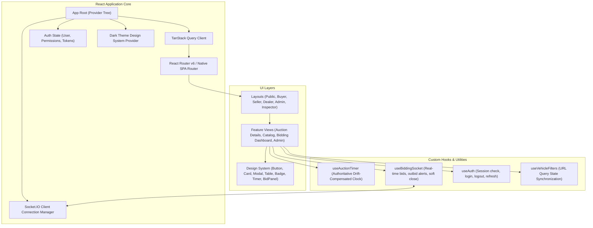
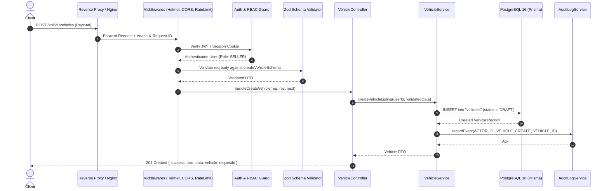
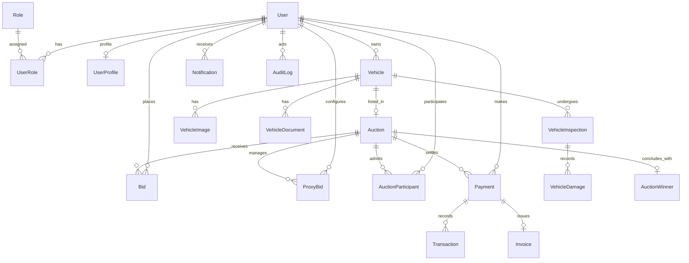
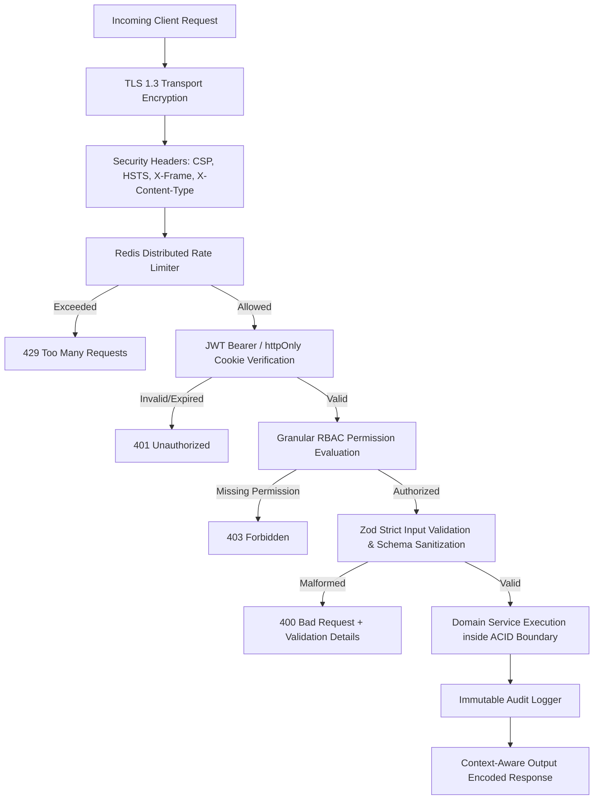
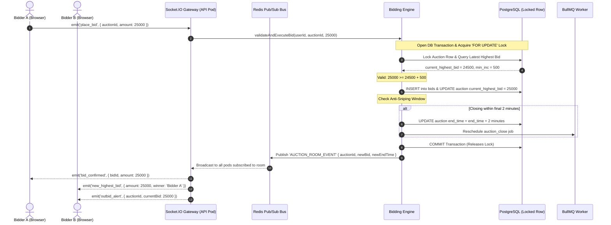

# AutoBid Pro — System Architecture & Technical Specifications
## Phase 2: Comprehensive Architecture Document

---

## 1. System Architecture

AutoBid Pro is architected as a high-performance **Modular Monolith in Pure JavaScript (Node.js 22 LTS with native ES Modules)** paired with a **React 18+ SPA (Vite + Tailwind CSS)** and an asynchronous worker tier.

### 1.1 End-to-End System Topology

```mermaid
graph TD
    subgraph Client Tier
        WebBrowser["Web Client (React SPA - Pure JS/JSX)"]
        MobileBrowser["Mobile Client (Responsive PWA)"]
    end

    subgraph Edge & Ingress
        DNS["DNS / Route 53"]
        CDN["CDN & WAF (Cloudflare / CloudFront)"]
        LoadBalancer["Application Load Balancer / Nginx"]
    end

    subgraph Application Tier
        APIInstance1["Node.js API Instance 1 (ESM)"]
        APIInstance2["Node.js API Instance 2 (ESM)"]
        WorkerInstance["BullMQ Background Worker (Node.js ESM)"]
    end

    subgraph Real-Time & Caching Tier
        RedisPubSub[("Redis 7 (Pub/Sub Adapter)")]
        RedisCache[("Redis 7 (Session, Rate Limits & BullMQ)")]
    end

    subgraph Relational Persistence Tier
        PrimaryDB[("PostgreSQL 16 (Primary - Read/Write)")]
        ReplicaDB[("PostgreSQL 16 (Read Replica)")]
    end

    subgraph External Services
        S3Storage[("S3 / Cloudflare R2 (Media & Documents)")]
        StripeGateway["Stripe API (Payment & Pre-Auth Holds)"]
        EmailGateway["Transactional Email (Resend / SES)"]
    end

    Client Tier --> DNS --> CDN --> LoadBalancer
    LoadBalancer -->|HTTP/REST| APIInstance1
    LoadBalancer -->|HTTP/REST| APIInstance2
    LoadBalancer -->|WebSocket / WSS| APIInstance1
    LoadBalancer -->|WebSocket / WSS| APIInstance2

    APIInstance1 <--> RedisPubSub
    APIInstance2 <--> RedisPubSub
    APIInstance1 <--> RedisCache
    APIInstance2 <--> RedisCache

    APIInstance1 --> PrimaryDB
    APIInstance2 --> PrimaryDB
    APIInstance1 -.->|Read-Only Queries| ReplicaDB
    APIInstance2 -.->|Read-Only Queries| ReplicaDB
    PrimaryDB -.->|Streaming Replication| ReplicaDB

    WorkerInstance <--> RedisCache
    WorkerInstance --> PrimaryDB
    WorkerInstance --> EmailGateway

    APIInstance1 --> S3Storage
    APIInstance1 --> StripeGateway
```

---

## 2. Component Architecture (Modular Monolith)

The application adheres strictly to Clean / Hexagonal architecture principles. The monolith is partitioned into distinct domain modules with strictly defined public interfaces. Domain services encapsulate business logic and communicate across module boundaries via exported service functions rather than direct internal database queries.

```mermaid
graph TD
    subgraph API Layer (Transport)
        Router["Express App & Route Registry"]
        Middlewares["Global Middlewares (CORS, Helmet, RateLimiter, RequestContext)"]
        AuthGuards["Auth & RBAC Guards"]
        Controllers["Domain Controllers (Express Handlers)"]
        Validation["Zod Request Validation Schemas"]
    end

    subgraph Domain Service Layer (Pure Business Logic)
        AuthService["Auth & Identity Service"]
        VehicleService["Vehicle Lifecycle Service"]
        AuctionService["Auction Scheduling & Engine"]
        BiddingEngine["Real-Time Bidding & Concurrency Engine"]
        ProxyBiddingService["Proxy Auto-Bid Calculator"]
        PaymentService["Payment, Escrow & Deposit Service"]
        NotificationService["Notification & Dispatch Service"]
        MessagingService["Moderated Messaging Service"]
        AuditService["Audit & Security Logging Service"]
        AdminService["Platform Governance Service"]
    end

    subgraph Data Access Layer
        PrismaClient["Prisma ORM (JavaScript Client)"]
        TxManager["Database Transaction Manager"]
        RedisClient["ioredis Client"]
    end

    subgraph Storage & External Gateways
        S3Adapter["S3 / R2 Pre-Signed URL Generator"]
        PaymentAdapter["Stripe Webhook & Payment Client"]
    end

    Router --> Middlewares --> AuthGuards --> Validation --> Controllers
    Controllers --> AuthService
    Controllers --> VehicleService
    Controllers --> AuctionService
    Controllers --> BiddingEngine
    Controllers --> PaymentService
    Controllers --> MessagingService
    Controllers --> AdminService

    BiddingEngine --> AuctionService
    BiddingEngine --> ProxyBiddingService
    BiddingEngine --> NotificationService
    AuctionService --> NotificationService
    PaymentService --> AuditService

    AuthService --> TxManager
    VehicleService --> TxManager
    AuctionService --> TxManager
    BiddingEngine --> TxManager
    PaymentService --> TxManager
    AdminService --> TxManager

    TxManager --> PrismaClient
    BiddingEngine --> RedisClient
    NotificationService --> RedisClient
    VehicleService --> S3Adapter
    PaymentService --> PaymentAdapter
```

---

## 3. Frontend Architecture

The frontend is a modern single-page application built with **React 18/19, Vite, Tailwind CSS, and TanStack Query**, authored exclusively in pure JavaScript (`.jsx` / `.js`).



### 3.1 Frontend Design Principles
- **Dark Luxury Automotive Aesthetic**: Curated color palette using deep obsidian/slate backgrounds (`#0B0F17`, `#111827`), elevated card surfaces (`#1E293B`), refined borders (`#334155`), with high-visibility accent colors (Electric Amber `#F59E0B` for countdowns/active bids, Emerald `#10B981` for winning status, Rose `#EF4444` for outbid alerts).
- **Zero Layout Shifts**: Skeleton loaders strictly mimic the layout of vehicle image carousels, inspection diagrams, and bid tables.
- **Micro-State Resilience**: Every critical view handles 7 states explicitly: Loading, Success, Empty, Error, Unauthorized, Forbidden, and Offline/Reconnecting.

---

## 4. Backend Architecture

The backend operates as a Node.js 22 LTS ES Module runtime. Requests proceed through a deterministic pipeline that guarantees validation, authentication, authorization, and error containment before invoking domain logic.



### 4.1 Backend Directory Architecture (Pure JavaScript ESM)
```
apps/api/
├── src/
│   ├── server.js               # Application bootstrap & graceful shutdown
│   ├── app.js                  # Express app configuration & middleware pipeline
│   ├── config/                 # Environment variables & runtime constants
│   ├── middlewares/            # Auth, RBAC, error handler, rate limiter, logger
│   ├── modules/
│   │   ├── auth/               # Auth routes, controllers, services, repositories
│   │   ├── users/              # User profile, preferences, address management
│   │   ├── vehicles/           # Vehicle catalog, VIN decoding, media, lifecycle
│   │   ├── inspections/        # Inspection checklists, damage mapping
│   │   ├── auctions/           # Auction scheduling, status state machine, timers
│   │   ├── bidding/            # Real-time bidding engine, socket handlers
│   │   ├── proxy-bids/         # Auto-bid calculations and triggers
│   │   ├── payments/           # Deposit holds, settlement, Stripe webhooks
│   │   ├── messaging/          # Moderated user messaging & PII filtering
│   │   ├── notifications/      # Notification dispatchers (in-app + email)
│   │   ├── reviews/            # Verified buyer/seller reviews
│   │   ├── admin/              # Administrative queues, approvals, system settings
│   │   └── audit/              # Immutable audit logging repository & service
│   ├── workers/                # BullMQ queue definitions & job processors
│   └── utils/                  # Cryptography, math, date, standardized errors
```

---

## 5. Database Architecture & Concurrency Model

### 5.1 Entity Relational Overview



### 5.2 Concurrency & Bidding Locking Strategy

When a bid is submitted, concurrency race conditions are mitigated via **Pessimistic Row-Level Locking** in PostgreSQL:

```sql
-- Step 1: Open Transaction
BEGIN;

-- Step 2: Lock the target auction row exclusively
SELECT id, status, current_highest_bid, minimum_increment, end_time, seller_id
FROM auctions
WHERE id = $1
FOR UPDATE;

-- Step 3: Server evaluates authoritative state
-- If status != 'LIVE' or now() >= end_time or $bid_amount < (current_highest_bid + minimum_increment)
-- Rollback and return standardized error (e.g., BID_TOO_LOW or AUCTION_CLOSED)

-- Step 4: Insert the bid
INSERT INTO bids (id, auction_id, bidder_id, amount, created_at)
VALUES (gen_random_uuid(), $1, $bidder_id, $bid_amount, now());

-- Step 5: Update the auction state
UPDATE auctions
SET current_highest_bid = $bid_amount,
    bid_count = bid_count + 1,
    current_winner_id = $bidder_id,
    updated_at = now()
WHERE id = $1;

-- Step 6: Commit Transaction & Release Lock
COMMIT;
```

---

## 6. Infrastructure Architecture

```mermaid
graph TD
    Internet((Public Internet)) --> Cloudflare[Cloudflare CDN / WAF / DDoS Shield]
    Cloudflare -->|HTTPS / WSS| NginxIngress[Nginx Reverse Proxy & SSL Termination]
    
    subgraph Private Virtual Network (VPC)
        subgraph DMZ Subnet
            NginxIngress
        end

        subgraph Application Subnet (Private)
            API_1[Node.js 22 API Pod 1]
            API_2[Node.js 22 API Pod 2]
            WorkerPod[BullMQ Background Worker Pod]
        end

        subgraph Data Subnet (Strictly Isolated)
            RedisMaster[(Redis 7 Cluster)]
            PostgresMaster[(PostgreSQL 16 Primary)]
            PostgresReplica[(PostgreSQL 16 Read Replica)]
        end
    end

    subgraph External Cloud Services
        S3Bucket[Encrypted S3 / R2 Storage]
        StripeAPIs[Stripe Gateway]
        EmailAPIs[Transactional Email Service]
    end

    NginxIngress --> API_1
    NginxIngress --> API_2
    API_1 <--> RedisMaster
    API_2 <--> RedisMaster
    API_1 --> PostgresMaster
    API_2 --> PostgresMaster
    API_1 -.-> PostgresReplica
    API_2 -.-> PostgresReplica
    WorkerPod <--> RedisMaster
    WorkerPod --> PostgresMaster
    API_1 --> S3Bucket
    API_1 --> StripeAPIs
    WorkerPod --> EmailAPIs
```

---

## 7. Security Architecture (OWASP ASVS Level 2)



### 7.1 Security Controls Matrix
1. **Authentication**: Argon2id password hashing with custom salt; short-lived access tokens (15m) + rotating refresh tokens (7d) stored in `httpOnly`, `Secure`, `SameSite=Strict` cookies.
2. **Brute Force Protection**: Dynamic lockout ladder: 5 consecutive failed attempts lock account for 15 minutes.
3. **Data Protection**: Sensitive payment data is tokenized by Stripe; no card numbers ever pass through our servers.
4. **Injection Prevention**: Parameterized queries via Prisma ORM completely prevent SQL injection.
5. **Direct Media Uploads**: Clients upload images/videos directly to S3 via pre-signed URLs with strict MIME type and file-size constraints validated server-side.

---

## 8. Real-Time Bidding Architecture



---

## 9. Deployment & DevOps Architecture

### 9.1 Multi-Stage Containerization Architecture
- **API Container**: Node.js 22 Alpine, non-root user (`node`), production dependencies only, dumb-init for graceful signal handling (`SIGTERM`/`SIGINT`).
- **Worker Container**: Lightweight Node.js 22 Alpine instance sharing the core domain services to process BullMQ tasks.
- **Frontend Container**: Multi-stage build (Node build $\rightarrow$ Nginx Alpine edge serving static assets with gzip/brotli compression and cache headers).

```mermaid
graph LR
    subgraph CI/CD Pipeline (GitHub Actions)
        Commit[Git Commit / PR] --> Lint[Lint & Syntax Check]
        Lint --> UnitTests[Vitest Unit Tests]
        UnitTests --> IntTests[Supertest Integration Tests]
        IntTests --> SecurityScan[Dependency & Audit Scan]
        SecurityScan --> BuildImages[Docker Multi-Stage Build]
        BuildImages --> PushRegistry[Push to Container Registry]
        PushRegistry --> DeployStaging[Deploy to Staging Environment]
        DeployStaging --> E2ETests[Playwright Smoke / E2E Tests]
        E2ETests --> DeployProd[Rolling Production Deployment]
    end
```

---

## 10. Summary & Sign-off

The architectural framework outlined above guarantees:
1. **High Concurrency Safety**: Guaranteed serialized bid execution without race conditions.
2. **Scalability**: Stateless Node.js backend instances horizontally scalable across multi-node clusters using Redis Pub/Sub.
3. **Strict Domain Boundaries**: Cleanly isolated modules in pure JavaScript ESM ready for future microservice extraction if needed.
4. **Security**: Full alignment with OWASP ASVS Level 2 standards.
