# AutoBid Pro — Database Architecture & Schema Specification
## Phase 3: Entity Relationship Design, Constraints, Indexes & Seed Strategy

---

## 1. Entity Relationship Diagram (ERD)

```mermaid
erDiagram
    %% Identity
    User ||--o{ UserRole : assigned
    Role ||--o{ UserRole : belongs
    Role ||--o{ RolePermission : grants
    Permission ||--o{ RolePermission : defines
    User ||--o| UserProfile : has
    User ||--o{ Session : maintains
    User ||--o{ RefreshToken : issues
    User ||--o| MFAConfiguration : protects

    %% Profiles & Addresses
    UserProfile ||--o{ Address : locates
    UserProfile ||--o{ PhoneNumber : contacts
    UserProfile ||--o| UserPreference : customizes
    UserProfile ||--o{ UserDocument : verifies

    %% Vehicles & Inspections
    User ||--o{ Vehicle : lists
    Vehicle ||--o| Auction : listed_in
    Vehicle ||--o{ VehicleImage : displays
    Vehicle ||--o{ VehicleVideo : demonstrates
    Vehicle ||--o{ VehicleDocument : provides
    Vehicle ||--o| VehicleSpecification : specifies
    Vehicle ||--o{ VehicleFeature : equips
    Vehicle ||--o{ VehicleHistory : records
    Vehicle ||--o{ VehicleInspection : inspects
    VehicleInspection ||--o{ VehicleDamage : maps

    %% Auctions & Bids
    Auction ||--o{ Bid : receives
    Auction ||--o{ ProxyBid : manages
    Auction ||--o{ AuctionParticipant : registers
    Auction ||--o| AuctionWinner : concludes
    Auction ||--o{ AuctionRule : regulates
    User ||--o{ Bid : places
    User ||--o{ ProxyBid : configures
    User ||--o{ AuctionParticipant : enters

    %% Payments & Settlements
    User ||--o{ Payment : executes
    Auction ||--o{ Payment : settles
    Payment ||--o{ Transaction : logs
    Payment ||--o| Invoice : generates
    Payment ||--o{ Refund : processes

    %% Engagement & Marketplace
    User ||--o{ Favorite : marks
    Vehicle ||--o{ Favorite : tagged
    User ||--o{ Watchlist : tracks
    Vehicle ||--o{ Watchlist : monitored
    User ||--o{ SavedSearch : saves

    %% Messaging & Support
    Conversation ||--o{ ConversationParticipant : includes
    User ||--o{ ConversationParticipant : joins
    Conversation ||--o{ Message : contains
    Message ||--o{ MessageAttachment : attaches
    User ||--o{ Notification : receives
    User ||--o{ SupportTicket : submits
    SupportTicket ||--o{ TicketMessage : replies

    %% Governance & Auditing
    User ||--o{ AuditLog : acts
    User ||--o{ AdminAction : executes
    User ||--o{ Review : writes
    Review ||--o| ReviewResponse : answers
```



---

## 2. Table Groups & Entities Summary

| Group | Entities Count | Key Tables |
| :--- | :--- | :--- |
| **IAM & Auth** | 11 | `users`, `roles`, `permissions`, `user_roles`, `sessions`, `refresh_tokens`, `login_attempts`, `mfa_configurations` |
| **User Profiles** | 5 | `user_profiles`, `addresses`, `phone_numbers`, `user_preferences`, `user_documents` |
| **Vehicles** | 8 | `vehicles`, `vehicle_images`, `vehicle_videos`, `vehicle_documents`, `vehicle_specifications`, `vehicle_features`, `vehicle_histories` |
| **Condition** | 2 | `vehicle_inspections`, `vehicle_damages` |
| **Auctions** | 5 | `auctions`, `auction_rules`, `auction_participants`, `auction_winners`, `bid_increments` |
| **Bidding** | 2 | `bids`, `proxy_bids` |
| **Marketplace** | 4 | `favorites`, `watchlists`, `saved_searches`, `search_histories` |
| **Sellers & Dealers**| 3 | `seller_profiles`, `dealer_profiles`, `dealer_documents` |
| **Payments** | 4 | `payments`, `transactions`, `invoices`, `refunds` |
| **Communication** | 5 | `conversations`, `conversation_participants`, `messages`, `message_attachments`, `notifications` |
| **Reputation** | 2 | `reviews`, `review_responses` |
| **Administration**| 5 | `audit_logs`, `admin_actions`, `security_events`, `system_settings`, `feature_flags` |
| **Support** | 4 | `support_tickets`, `ticket_messages`, `faqs`, `reports` |
| **Total** | **60 Models** | Complete schema declared in [apps/api/prisma/schema.prisma](file:///home/kashifhm333/Desktop/Project/Online%20Bid/apps/api/prisma/schema.prisma) |

---

## 3. Indexing Strategy & Query Optimization

To guarantee sub-50ms query response times under high concurrency and multi-faceted search:

### 3.1 Bidding & Auction Hot-Path Indexes
- `bids(auction_id, amount DESC)`: Enables instantaneous retrieval of the current highest bid and rapid leaderboard rendering.
- `bids(auction_id, created_at)`: Optimizes real-time bid history feeds and chronological audit reconstructions.
- `auctions(status, end_time)`: Powers the high-frequency background worker query that sweeps for expired or anti-sniping auto-extended auctions (`WHERE status = 'LIVE' AND end_time <= now()`).
- `proxy_bids(auction_id, is_active)`: Accelerates automated proxy counter-bid evaluation within the locked transaction loop.

### 3.2 Vehicle Catalog & Search Filtering Indexes
- `vehicles(make, model, year)`: Fast compound lookup for vehicle discovery filters.
- `vehicles(status, created_at)`: Immediate indexing for active inventory sorting (`WHERE status = 'LIVE' ORDER BY created_at DESC`).
- `vehicles(vin)`: Unique B-Tree index for duplicate VIN detection and Carfax/VIN-decoder cache lookups.
- `vehicle_images(vehicle_id, display_order)`: Guarantees zero sort overhead when fetching ordered photo galleries.

### 3.3 Security & Session Indexes
- `refresh_tokens(token_hash)`: Instant lookups for rotation verification.
- `sessions(user_id, expires_at)`: Quick revocation of expired sessions during housekeeping routines.
- `login_attempts(email, created_at)` and `login_attempts(ip_address, created_at)`: Dynamic calculation of failed attempt thresholds for brute-force lockouts.
- `audit_logs(actor_id, created_at)`: High-performance compliance query filtering.

---

## 4. Referential Integrity & Cascading Rules

1. **Strict Financial & Operational Integrity (`onDelete: Restrict`)**:
   - `bids` $\rightarrow$ `User` / `Auction`: Bids cannot be orphaned; users with historical bids cannot be hard-deleted.
   - `auctions` $\rightarrow$ `Vehicle`: Vehicles actively listed in auctions cannot be deleted.
   - `payments` $\rightarrow$ `User`: Financial payment records can never be deleted upon user deactivation.
2. **Dependent Lifecycle Teardowns (`onDelete: Cascade`)**:
   - `Vehicle` $\rightarrow$ `VehicleImage`, `VehicleVideo`, `VehicleDocument`, `VehicleFeature`, `VehicleSpecification`: Image and document metadata cleanly cascade when an unlisted vehicle draft is discarded.
   - `Conversation` $\rightarrow$ `ConversationParticipant`, `Message`, `MessageAttachment`: Direct messaging cleanups cascade seamlessly.
   - `User` $\rightarrow$ `UserProfile`, `Session`, `RefreshToken`: Transient authentication artifacts clean up automatically.

---

## 5. Migration Strategy & Operational Safety

### 5.1 Declarative Migration Pipeline
1. Primary schema authored in `apps/api/prisma/schema.prisma`.
2. Developer workflow:
   ```bash
   npx prisma migrate dev --name <descriptive_name>
   ```
3. Production migration execution:
   ```bash
   npx prisma migrate deploy
   ```

### 5.2 Zero-Downtime Migration Policy (Expand & Contract)
- **Adding Columns**: Always add as `NULL` or with a safe `@default(...)` value.
- **Renaming Columns**: Create new column $\rightarrow$ write to both $\rightarrow$ backfill existing rows $\rightarrow$ switch read traffic $\rightarrow$ drop old column in a subsequent release.
- **Dropping Columns**: Mark as deprecated $\rightarrow$ remove code dependencies $\rightarrow$ drop column via migration.

---

## 6. Comprehensive Development Seed Strategy

The seed script will populate the database with realistic, high-fidelity automobile marketplace data:

1. **Users & Identities (30+ Users across 11 Roles)**:
   - Super Admin: `superadmin@autobidpro.com`
   - Platform Administrator: `admin@autobidpro.com`
   - Auction Manager: `manager@autobidpro.com`
   - Vehicle Inspector: `inspector@autobidpro.com`
   - Finance Manager: `finance@autobidpro.com`
   - Support Agent: `support@autobidpro.com`
   - Commercial Dealers: `dealer.apex@autobidpro.com`, `dealer.velocity@autobidpro.com`
   - Private Sellers: 8 verified individual sellers.
   - Active Buyers: 15 active bidding accounts with pre-authorized deposits.
2. **Vehicles (50+ Vehicles)**:
   - High-end exotics (Porsche 911 GT3 RS, Ferrari 488, McLaren 720S).
   - Classic collector cars (1967 Ford Mustang Shelby GT500, 1989 BMW E30 M3).
   - Modern performance & EVs (Tesla Model S Plaid, BMW M5 CS, Audi RS6 Avant).
   - Off-road & Trucks (Ford F-150 Raptor R, RAM TRX, Land Rover Defender).
   - Everyday sports sedans (Mercedes-AMG C63, Alfa Romeo Giulia Quadrifoglio).
3. **Auctions**:
   - 20 `LIVE` auctions with active countdowns, dynamic bid increments, and realistic bid ladders.
   - 10 `SCHEDULED` upcoming auctions launching in 24–72 hours.
   - 15 `SOLD` completed auctions with winner records and settled invoices.
   - 5 `UNSOLD` auctions where reserve prices were not met.
4. **Inspections & Damage Maps**:
   - Realistic multi-point OBD2 diagnostic logs, paint-meter readings, and coordinate-mapped damage markers.
5. **Real-time Bid Histories & Proxies**:
   - Over 300 sequential bids reflecting competitive bidding, anti-sniping soft closes, and proxy counter-bids.
