# AutoBid Pro Domain Class Diagram

This document presents the complete Object-Oriented Domain Model for AutoBid Pro, mapping all entities, attributes, relationships, and business operations across Identity, Vehicle Catalog, Auction Engine, Bidding Infrastructure, and Financial Escrow.

```mermaid
classDiagram
    direction TB

    %% ==========================================
    %% IDENTITY & ACCESS MANAGEMENT
    %% ==========================================
    class User {
        +UUID id
        +String email
        +String passwordHash
        +String firstName
        +String lastName
        +UserStatus status
        +Boolean emailVerified
        +Int failedLoginAttempts
        +DateTime lockedUntil
        +DateTime lastLoginAt
        +DateTime createdAt
        +register(data) User
        +authenticate(password) Boolean
        +lockAccount(duration) void
        +resetPassword(newHash) void
    }

    class UserProfile {
        +UUID id
        +UUID userId
        +String phoneNumber
        +String avatarUrl
        +String addressLine1
        +String city
        +String state
        +String postalCode
        +String country
        +updateProfile(data) void
    }

    class Role {
        +UUID id
        +String name
        +String description
        +Boolean isSystem
    }

    class Permission {
        +UUID id
        +String code
        +String description
        +String category
    }

    class UserRole {
        +UUID userId
        +UUID roleId
        +DateTime assignedAt
    }

    class Session {
        +UUID id
        +UUID userId
        +String token
        +String ipAddress
        +String userAgent
        +DateTime expiresAt
        +Boolean isRevoked
    }

    class RefreshToken {
        +UUID id
        +UUID userId
        +String tokenHash
        +UUID familyId
        +Boolean isRevoked
        +DateTime expiresAt
    }

    %% ==========================================
    %% VEHICLE CATALOG & CURATION
    %% ==========================================
    class Vehicle {
        +UUID id
        +String vin
        +String make
        +String model
        +Int year
        +String trim
        +Int mileage
        +FuelType fuelType
        +TransmissionType transmission
        +DriveType driveType
        +String exteriorColor
        +String interiorColor
        +BodyType bodyType
        +TitleStatus titleStatus
        +VehicleStatus status
        +UUID sellerId
        +submitForReview() void
        +approveListing() void
        +rejectListing(reason) void
    }

    class VehicleSpecification {
        +UUID id
        +UUID vehicleId
        +Int horsepower
        +Int torqueFtLbs
        +Float displacementLiters
        +Int cylinders
        +Int curbWeightLbs
    }

    class VehicleImage {
        +UUID id
        +UUID vehicleId
        +String url
        +String category
        +Int displayOrder
        +Boolean isFeatured
    }

    class VehicleInspection {
        +UUID id
        +UUID vehicleId
        +UUID inspectorId
        +Float overallScore
        +Int verifiedMileage
        +Boolean odometerVerified
        +String summaryNotes
        +InspectionStatus status
        +submitReport() void
        +approveReport() void
    }

    class DamageReport {
        +UUID id
        +UUID inspectionId
        +String panelLocation
        +DamageSeverity severity
        +String description
        +String photoUrl
    }

    %% ==========================================
    %% AUCTION ENGINE & REAL-TIME BIDDING
    %% ==========================================
    class Auction {
        +UUID id
        +UUID vehicleId
        +Decimal startingPrice
        +Decimal reservePrice
        +Decimal currentHighestBid
        +Decimal minimumIncrement
        +DateTime startTime
        +DateTime endTime
        +DateTime originalEndTime
        +AuctionStatus status
        +Int bidCount
        +Int extensionCount
        +Int maxExtensions
        +Int antiSnipingWindowSec
        +Int antiSnipingExtSec
        +Decimal depositRequired
        +Boolean reserveMet
        +placeBid(bidderId, amount) BidResult
        +extendAntiSniping() void
        +closeAuction() CloseResult
    }

    class Bid {
        +UUID id
        +UUID auctionId
        +UUID bidderId
        +Decimal amount
        +BidStatus status
        +String ipAddress
        +DateTime createdAt
    }

    class ProxyBid {
        +UUID id
        +UUID auctionId
        +UUID bidderId
        +Decimal maxAmount
        +Boolean isActive
        +DateTime createdAt
        +evaluateCounterBid(currentBid, minInc) Decimal
    }

    class AuctionParticipant {
        +UUID auctionId
        +UUID userId
        +Boolean depositPaid
        +UUID depositPaymentId
        +DateTime registeredAt
    }

    class AuctionWinner {
        +UUID auctionId
        +UUID winnerId
        +Decimal winningBid
        +Decimal buyerPremium
        +Decimal totalAmount
        +DateTime wonAt
        +PaymentStatus settlementStatus
    }

    %% ==========================================
    %% FINANCIAL PAYMENTS & ESCROW
    %% ==========================================
    class Payment {
        +UUID id
        +UUID userId
        +UUID auctionId
        +Decimal amount
        +String currency
        +PaymentType type
        +PaymentStatus status
        +String paymentProvider
        +String providerPaymentId
        +String idempotencyKey
        +DateTime authorizedAt
        +DateTime capturedAt
        +captureHold() void
        +releaseHold() void
    }

    class AuditLog {
        +UUID id
        +UUID actorId
        +String action
        +String resource
        +UUID resourceId
        +JSON stateDiff
        +String ipAddress
        +DateTime createdAt
    }

    %% ==========================================
    %% RELATIONSHIPS & ASSOCIATIONS
    %% ==========================================
    User "1" --> "1" UserProfile : has
    User "1" --> "*" UserRole : assigned
    Role "1" --> "*" UserRole : mapped
    Role "1" --> "*" Permission : contains
    User "1" --> "*" Session : maintains
    User "1" --> "*" RefreshToken : issues
    User "1" --> "*" Vehicle : owns_as_seller
    User "1" --> "*" Bid : places
    User "1" --> "*" ProxyBid : sets
    User "1" --> "*" Payment : authorizes

    Vehicle "1" *-- "1" VehicleSpecification : specifies
    Vehicle "1" *-- "*" VehicleImage : displays
    Vehicle "1" *-- "*" VehicleInspection : assessed_by
    VehicleInspection "1" *-- "*" DamageReport : details
    Vehicle "1" <--> "1" Auction : auctioned_via

    Auction "1" *-- "*" Bid : receives
    Auction "1" *-- "*" ProxyBid : configures
    Auction "1" --> "*" AuctionParticipant : registers
    Auction "1" --> "0..1" AuctionWinner : concludes_with
    Auction "1" --> "*" Payment : settles

    User "1" --> "*" AuditLog : generates
```

