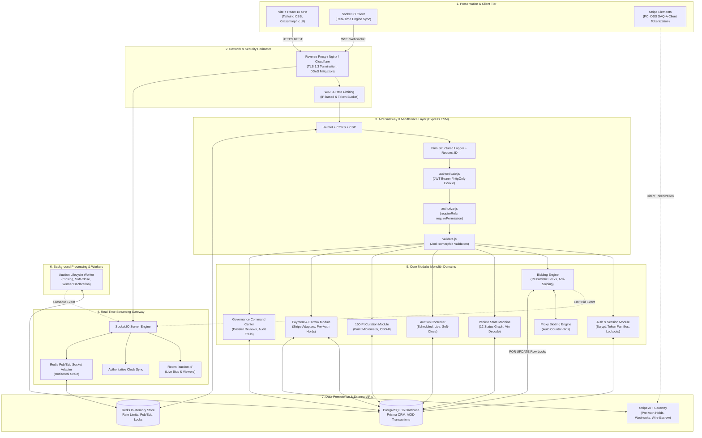

# AutoBid Pro UML System Architecture & Component Diagram

This document illustrates the tiered architectural layers of AutoBid Pro, showing component boundaries, communication protocols, security perimeters, and data persistence models.

