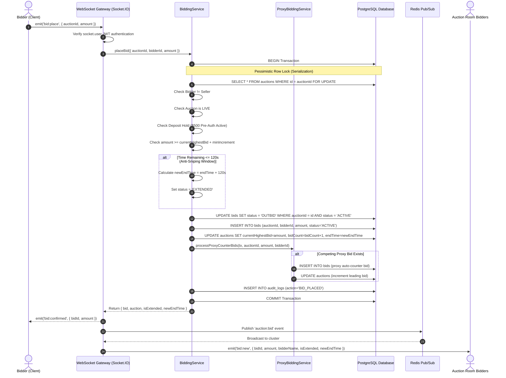
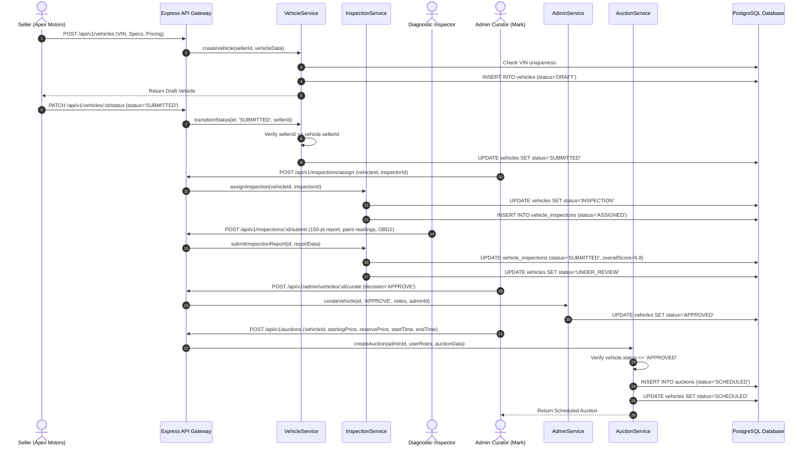
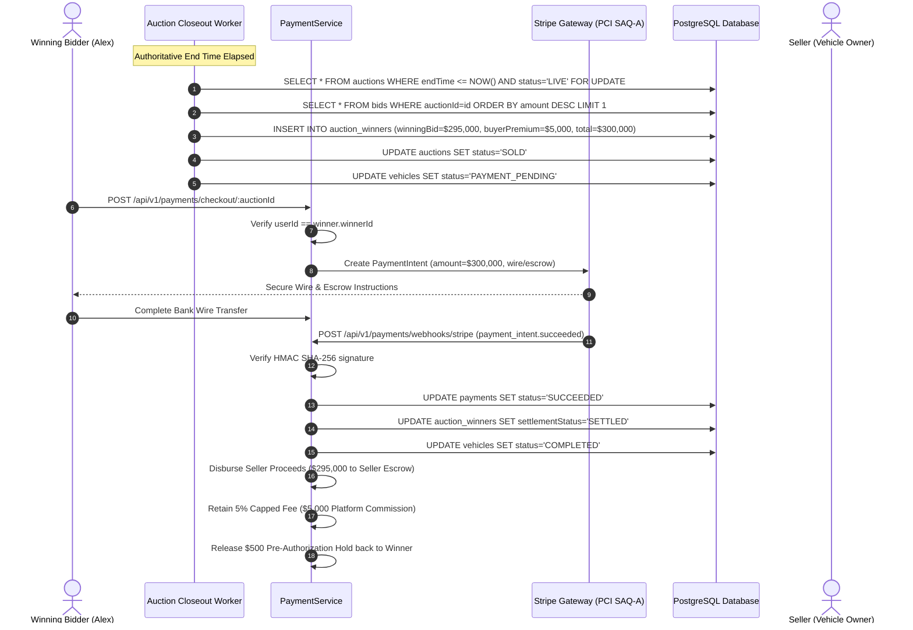

# AutoBid Pro UML Sequence Diagrams

This document details the critical runtime execution sequences for live real-time bidding, vehicle curation, and financial escrow settlement.

---

## 1. Real-Time Bidding & Anti-Sniping Soft-Close Sequence

Demonstrates sub-millisecond serialized bid processing utilizing PostgreSQL `SELECT ... FOR UPDATE` pessimistic locking, anti-sniping dynamic soft-close extension, automated proxy counter-bidding, and WebSocket multiplexing.

---

## 2. Vehicle Intake, 150-Point Curation & Auction Launch Sequence

Illustrates the end-to-end seller listing, diagnostic inspection report, administrative curation review, and auction scheduling workflow.

---

## 3. Pre-Authorization Deposit & Escrow Settlement Sequence

Details the financial transactions, Stripe pre-authorization hold, auction win finalization, capped buyer premium calculation, and escrow transfer.

