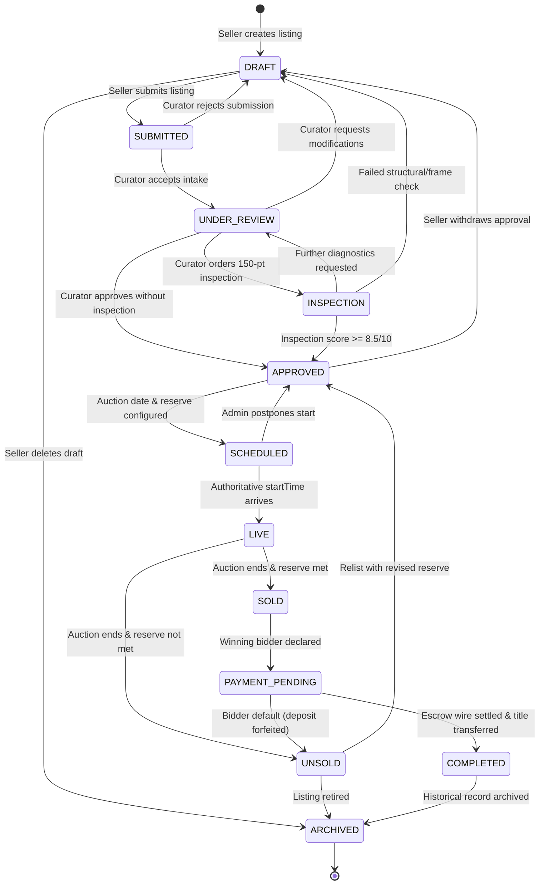
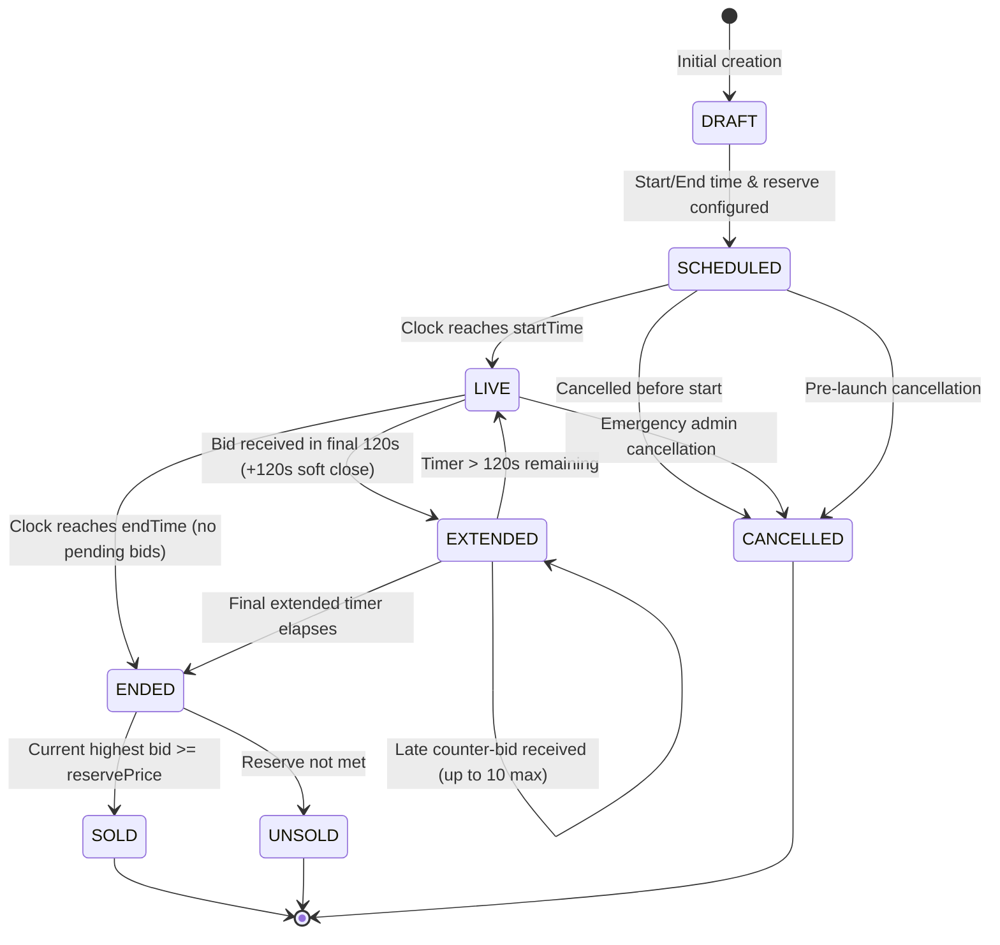
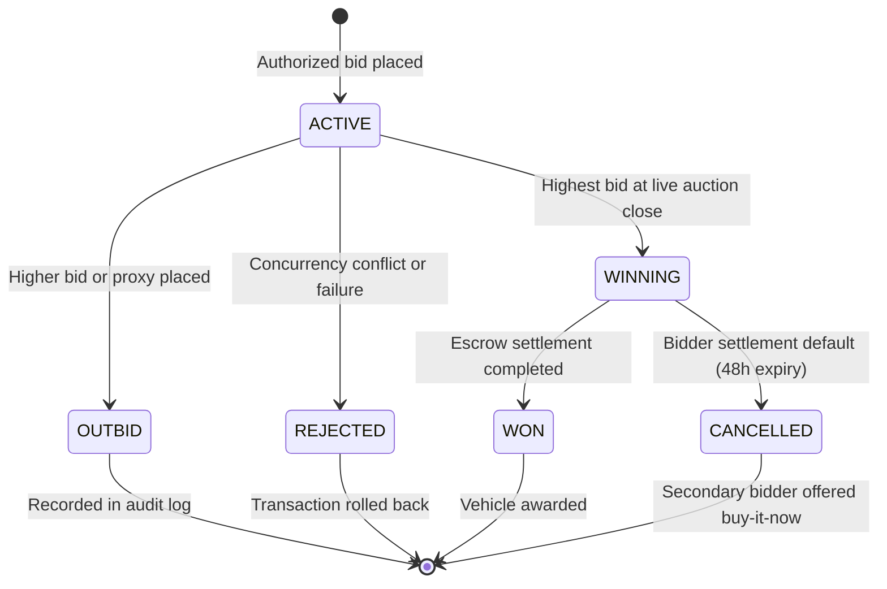

# AutoBid Pro UML State Machine Diagrams

This document formalizes the lifecycle state transitions enforced by the domain state machines across Vehicles, Auctions, and Bids.

---

## 1. Vehicle Lifecycle State Machine

Enforced by `vehicleStateMachine.js` with role-based access validation.

---

## 2. Auction Lifecycle State Machine

Enforced by `auctionWorker.js` and `biddingService.js`.

---

## 3. Bid Status State Machine

Tracks individual bid lifecycles inside `bids` database table.

